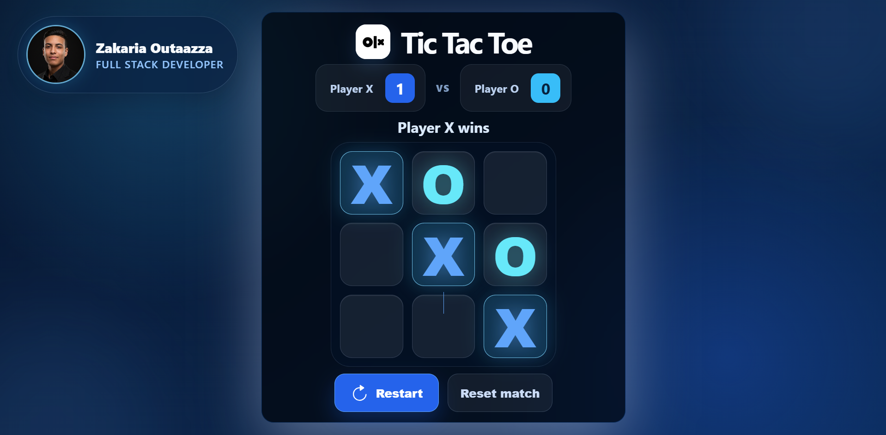

# 🎮 Tic Tac Toe – XO Game

A modern and interactive Tic Tac Toe game built with **React.js** and **JavaScript**, featuring a two-player gameplay experience, score tracking, and a clean user interface.

## 📸 Overview



Tic Tac Toe is a classic two-player game where players take turns placing X and O on a 3×3 grid. The first player to align three symbols horizontally, vertically, or diagonally wins the round.

The application also includes a score system to track each player's victories.

## ✨ Features

- Two-player gameplay (X and O).
- Interactive 3×3 game board.
- Automatic winner detection.
- Highlight the winning combination.
- Detect draw situations.
- Live player turn indicator.
- Score tracking for both players.
- Restart the current round without losing scores.
- Reset the entire match and clear scores.
- Responsive and user-friendly interface.

## 🛠️ Technologies Used

- React.js
- JavaScript (ES6+)
- CSS3
- React Icons
- HTML5

## 📁 Project Structure

```text
tic-tac-toe/
│
├── public/
│   ├── Zakaria.Ou.png
│   └── XOlogo.jpg
│
├── src/
│   ├── App.jsx
│   ├── App.css
│   └── main.jsx
│
├── index.html
├── .gitignore
├── package.json
├── package-lock.json
├── vite.config.js
└── README.md
```

## ⚙️ Installation

### 1. Clone the repository

```bash
git clone https://github.com/outaazzazakaria/Tic-Tac-Toe.git
```

### 2. Navigate to the project folder

```bash
cd tic-tac-toe
```

### 3. Install dependencies

```bash
npm install
```

### 4. Start the application

```bash
npm run dev
```

The application will run at:

`http://localhost:5173`

## 🎯 How to Play

1. The game starts with Player X.
2. Players take turns clicking on empty cells.
3. The first player to align three symbols wins the round.
4. If all cells are filled without a winner, the round ends in a draw.
5. Use **Restart** to start a new round while keeping the scores.
6. Use **Reset Match** to restart the game and reset both scores.

## 🏆 Winning Conditions

A player wins by aligning three symbols in one of these directions:

- Horizontally
- Vertically
- Diagonally

## 👨‍💻 Author

**Zakaria Outaazza**

- GitHub: [@outaazzazakaria](https://github.com/outaazzazakaria)
- LinkedIn: [Zakaria Outaazza](https://www.linkedin.com/in/zakaria-outaazza/)

---

⭐ If you like this project, feel free to star the repository!